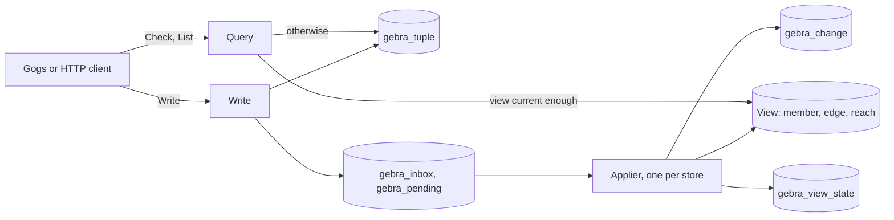
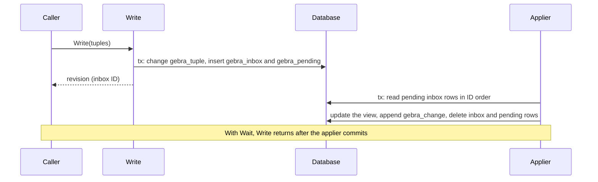
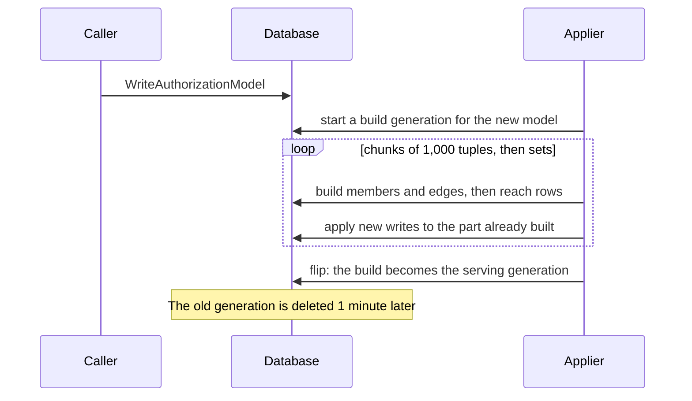

# Gebra

A fine-grained authorization engine for Go, modeled on Google's Zanzibar and compatible with the OpenFGA API and DSL.

Gebra runs embedded in Gogs as a Go package, or standalone as an HTTP server (`cmd/gebra`) that speaks OpenFGA's HTTP API. It stores everything in the application's own database, with Postgres as the database it is tuned for, and SQLite and MySQL supported. It keeps a materialized view of group membership, so checks and lists read precomputed rows instead of walking the graph, and lists are sorted and paged without limits.

## Features

- **OpenFGA model and API**: schema 1.1 DSL, direct and computed relations, tuple to userset, union, intersection, exclusion, type restrictions, wildcards, conditions (CEL), contextual tuples, Check, BatchCheck, Expand, ListObjects, StreamedListObjects, ListUsers, Read, ReadChanges and assertions.
- **Materialized view**: union-only relations are flattened into member, edge and reach rows, so a check is one statement at any nesting depth.
- **Sorting and no query limits**: lists page with keyset cursors over sortable object attributes (`string`, `int` and `time`), with no cap on results or depth.
- **Short write transactions**: a write commits its tuples, one inbox row and its pending changes, and returns. A single applier per store updates the view in batches.
- **Consistency chosen by the caller**: a write returns a revision token. Queries read the view by default, or pass `MinRevision` or `HIGHER_CONSISTENCY` to read their writes. A write can also `Wait` until it is applied.
- **Bounded staleness**: when the view falls more than `MaxStaleness` (1s by default) behind, default queries evaluate the graph instead.
- **Model changes without downtime**: a new model's view is built next to the live one, and queries switch to it at once when it is complete.
- **Observability**: OpenTelemetry traces and metrics for every operation, a client span for every SQL statement, applier lag and inbox depth.

## Architecture



- **Tuples** (`gebra_tuple`) are the source of truth. Read always sees every committed write.
- **Inbox** (`gebra_inbox`) holds the committed writes that the view does not include yet. Its ID is the revision token. `gebra_pending` holds their tuple changes, one row each, so that queries can tell whether a pending write affects their answer.
- **Applier**: one per store, elected with a Postgres advisory lock or MySQL `GET_LOCK`, and an in-process goroutine on SQLite. It is the only writer of the view, the change log and the view state, so the view needs no locks.
- **View**: `gebra_view_member` (direct members of a set), `gebra_view_edge` (set to set) and `gebra_view_reach` (the transitive closure of edges). Every row belongs to a generation, built for one model.
- **Database layer**: plain `database/sql` with explicit SQL, migrated by goose from `migrations/<dialect>`, with its own version table `gebra_db_version`.

A store is the unit of isolation: its tuples share the tables with every other store, but it has its own applier, inbox and view generations. Stores apply writes in parallel, and a store that falls behind does not slow the queries of others. Relations cannot refer to another store.

## Data flow

### Writes



Writes of the same tuple serialize on its row, so the later write gets the higher revision. Writes of different tuples may commit out of order, so a revision counts as applied when no inbox row at or below it is left.

### Queries

```mermaid
flowchart TD
  start[Check or list] --> tok{Token or HIGHER_CONSISTENCY?}
  tok -->|no| stale{Oldest pending write older than MaxStaleness?}
  tok -->|yes| met{Can a pending write change the answer?}
  met -->|no| view[Answer from the view]
  met -->|yes, list| partial[Re-check only the affected objects]
  met -->|yes, check| graph[Evaluate the graph]
  stale -->|no| view
  stale -->|yes| graph
```

- A default check is one statement: the compiled condition on the view, which also verifies the serving generation and that the store exists.
- A token check is also one statement, which adds whether any pending change can affect the answer, from the pending rows and the model's precomputed effects (`gebra_model_effect`).
- Relations with exclusion, intersection or conditions are evaluated from tuples as of the view's point in time, and every statement of a query reads one snapshot.

### Model changes



Until the flip, queries that name no model use the old model from its view, and queries that name the new model evaluate the graph. A newer model cancels the build of an older one.

## Performance

Gebra is benchmarked against OpenFGA through each server's HTTP API, with the same dataset, the same request stream at the same arrival rates, and the same correctness check. On a store of 100,000 repos, Gebra holds 5,000 requests/s with 0 violations, twice OpenFGA's rate. At 2,500 requests/s its check p99 is 2.5 ms against 634 ms for OpenFGA.

### Dataset and traffic

- **Dataset**: one store with 100,000 repos, 3,000 users, 1,000 teams and 500 orgs, which is 389,897 tuples. The model is GitHub-like: org owners and members, nested teams, repo admins, writers and readers, public repos (`user:*`) and blocked users (`can_read: reader but not blocked`). Gebra's view holds 308,997 member, 280,900 edge and 801,001 reach rows.
- **Traffic**: requests arrive at random (Poisson) times at a fixed rate, and latency counts from when a request was due, so time spent queued counts too. Users, repos and orgs are picked with a Zipf distribution.
  - 92% are checks.
  - 7% list a page of 50 repos a user reads. Lists may be stale, since opening a repo from a list issues a check.
  - 1% start a change session: a permission change (a collaborator, a team member, a team grant, a block, 100 collaborators at once, or a team added to an org), then, after a think time, a check with the write's token that must see the change, two more checks with the token, and sometimes a list. A check that misses its own write counts as a violation.
- **Rates**: 500, 1,000, 1,500, 2,000, 2,500, 5,000, 7,500, 10,000, 15,000, 20,000 and 30,000 requests/s, for 60 s each after a 10 s warmup, stopping after the first rate at which a p99 exceeds 1 s or the server falls behind the offered rate.
- **Clean state**: each server starts from a fresh database with exactly the dataset's tuples, and Postgres is restarted before each server's run.
- **Cross-check**: before its run, OpenFGA's answers are compared with a freshly loaded Gebra's on 300 checks and 300 lists, both in full and capped at 50. All 600 agree.

### Results

p50 / p99 in milliseconds, requests completed per second, and the CPU cores Postgres used.

| Server | Rate/s | Completed/s | Check | Token check | List | Write | Violations | Errors | Postgres cores |
|---|---|---|---|---|---|---|---|---|---|
| Gebra | 500 | 501 | **1.5 / 2.6** | 1.1 / 16.5 | 22.4 / 33.7 | **2.6 / 5.4** | 0 | 0 | 0.9 |
| OpenFGA | 500 | 501 | 2.6 / 10.9 | **1.7 / 3.4** | **3.1 / 15.6** | 3.4 / 12.2 | 0 | 0 | 0.6 |
| Gebra | 1,000 | 1,009 | **1.3 / 2.5** | **1.1 / 15.8** | **20.6 / 33.5** | **2.4 / 4.9** | 0 | 0 | 1.8 |
| OpenFGA | 1,000 | 1,009 | 2.4 / 61.8 | 1.6 / 33.4 | 3.0 / 69.7 | 3.0 / 42.3 | 0 | 0 | 1.0 |
| Gebra | 1,500 | 1,500 | **1.2 / 2.4** | **1.0 / 13.8** | **19.9 / 33.3** | **2.2 / 4.4** | 0 | 0 | 2.6 |
| OpenFGA | 1,500 | 1,500 | 3.0 / 355 | 2.1 / 234 | 5.4 / 256 | 3.4 / 215 | 0 | 0 | 1.3 |
| Gebra | 2,000 | 2,000 | **1.1 / 2.6** | **1.0 / 14.9** | **21.6 / 34.2** | **2.3 / 4.8** | 0 | 0 | 3.5 |
| OpenFGA | 2,000 | 2,000 | 28.7 / 655 | 9.5 / 492 | 19.9 / 515 | 16.6 / 451 | 0 | 0 | 1.4 |
| Gebra | 2,500 | 2,503 | **1.0 / 2.5** | **1.0 / 14.7** | **23.0 / 32.8** | **2.3 / 4.9** | 0 | 0 | 4.5 |
| OpenFGA | 2,500 | 2,503 | 70.5 / 634 | 36.8 / 523 | 49.6 / 493 | 43.2 / 481 | 0 | 1 | 1.6 |
| Gebra | 5,000 | 5,008 | **1.0 / 15.1** | **1.4 / 21.0** | **24.7 / 66.6** | **2.6 / 29.0** | 0 | 0 | 8.7 |
| OpenFGA | 5,000 | 4,586 | saturated | saturated | saturated | saturated | 0 | 0 | 2.0 |
| Gebra | 7,500 | 3,150 | saturated | saturated | saturated | saturated | 0 | 1,310 timeouts | 11.0 |

| Server | Highest rate held | Checks within 20 ms p99 | Token checks within 20 ms p99 | Bottleneck |
|---|---|---|---|---|
| Gebra | **5,000/s** | **up to 5,000/s** | **up to 2,500/s** | Postgres CPU: 4.5 cores of the machine's 6.4 at 2,500/s, 11 at 7,500/s |
| OpenFGA | 2,500/s | up to 500/s | up to 500/s | OpenFGA's own CPU: the machine used 10.8 cores at 2,500/s, Postgres only 1.6 |

OpenFGA's one error at 2,500/s was `400 cancelled: Request Cancelled`. At 5,000/s it queued for up to 30 s, and Gebra at 7,500/s for over a minute, until requests hit the 10 s client timeout.

Loading took 2 min 19 s for Gebra, with `COPY` and its view build, and 11 s for OpenFGA through its Write API, including the vacuum.

### Configuration

The benchmark is `TestApplierBenchHTTP` in `applierbench_http_test.go`, whose doc comment has the commands. Every setting below is chosen so that neither server gets an advantage the other lacks.

- **Machine**: Intel Xeon @ 2.60 GHz (Ice Lake), 16 vCPUs (8 cores with hyperthreading), 31 GiB of RAM, under KVM, with Postgres, both servers and the load generator on it and nothing else running. Go 1.27.4.
- **Postgres 15.20**, shared by both servers. Both databases are vacuumed and analyzed after loading.
  - Memory: `shared_buffers` 4 GB, `work_mem` 16 MB, `effective_cache_size` 16 GB, `maintenance_work_mem` 1 GB.
  - Connections and durability: `max_connections` 300, `synchronous_commit` on, `fsync` on.
  - WAL: `max_wal_size` 8 GB, `checkpoint_timeout` 15 min.
  - Planner: `random_page_cost` 1.1, `effective_io_concurrency` 200, `max_parallel_workers_per_gather` 0.
- **Gebra**, `cmd/gebra` built from this tree, as its own process:
  - `--db-type postgres`, `--db-max-open-conns 96`, which also sets 96 idle connections.
  - `--max-staleness 1s`, the default, which matches OpenFGA's 1s cache TTL below.
  - Tracing off (`OTEL_TRACES_SAMPLER=always_off`), Prometheus metrics on, as for OpenFGA.
  - Sessions set `max_parallel_workers_per_gather=0`, which `cmd/gebra` does for its short index lookups.
- **OpenFGA v1.23.0**, started by `testdata/openfga-bench.sh`, which downloads the release and checks its sha256:
  - `--datastore-engine postgres`, `--datastore-max-open-conns 96`, `--datastore-max-idle-conns 96`, to match Gebra's pool.
  - `--check-query-cache-enabled`, `--check-iterator-cache-enabled` and `--list-objects-iterator-cache-enabled`, each with a TTL of 1s, so default reads may be as stale as Gebra's. `HIGHER_CONSISTENCY` bypasses them.
  - `--check-cache-limit 1000000`, since the default of 10,000 entries would cap hit rates; `--cache-controller-enabled=false`, since the TTL already bounds staleness.
  - `--shared-iterator-enabled` and `--experimentals enable-check-optimizations,enable-list-objects-optimizations`, its performance options.
  - `--listObjects-max-results 50`, the page size, since OpenFGA has no paging.
  - `--listObjects-deadline 10s`, `--request-timeout 10s` and `--http-upstream-timeout 10s`, the benchmark's request timeout.
  - `--authn-method none`, `--trace-enabled=false`, `--log-level warn`, playground and profiler off.
- **Client**: one Go HTTP client for both servers, with keep-alives and 4,096 connections per host, so that it is never the bottleneck, and a 10s timeout per request.

What differs between the two:

- **Token checks**: Gebra passes the write's revision as `min_revision`. OpenFGA has no revision tokens, so it gets `HIGHER_CONSISTENCY`.
- **Lists**: Gebra returns a page of 50 sorted results. OpenFGA returns the first 50 it finds, unsorted, which favors OpenFGA.
- **Loading**: Gebra loads with `COPY` and builds its view. OpenFGA loads through its Write API. Neither is measured.
- **Rounds**: one round of each.

## Correctness

- Conformance tests cover every Zanzibar and OpenFGA feature listed above, and run against OpenFGA when `GEBRA_OPENFGA_URL` is set.
- Differential fuzzing compared Gebra with OpenFGA on 1,440 models and 35,610 queries. The remaining differences are intentional or OpenFGA bugs, and the minimized cases are replayed by `TestFuzzRegressions`.
- `GEBRA_WRITE_FUZZ` checks after every write that the view gives the same answers as graph evaluation, including across model changes and view builds.
- `GEBRA_PENDING_FUZZ` checks that queries with a token which the view answers despite pending writes give the answers of the latest state.
- Concurrency tests cover out-of-order commits, revision tokens, applier failover, view builds under concurrent writes and cancelled builds, and a check racing an applier batch or a flip.
- The suites run on SQLite, Postgres and MySQL 8.

## Known limits

- **View builds are slow on large stores**: a build covers one set at a time on one core, so a store of 1 million repos and 1,000 teams takes about 1 h 40 min to make a new model live.
- **Lists are the slowest query**: about 20 ms at p50 on the dataset above, since they sort their candidates before paging.
