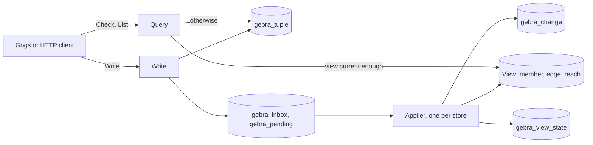
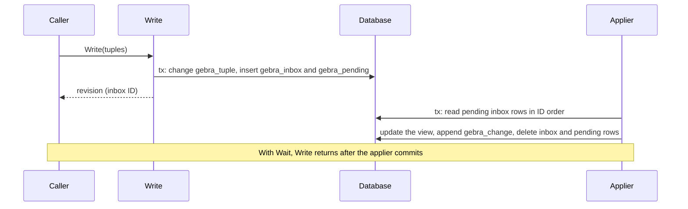
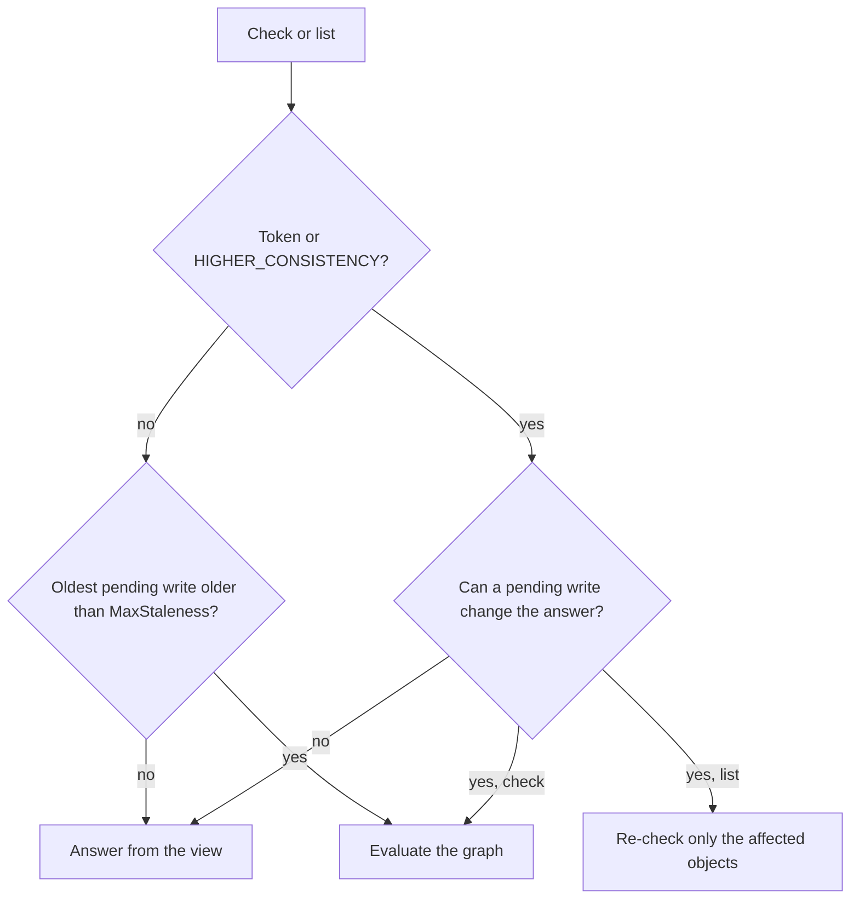
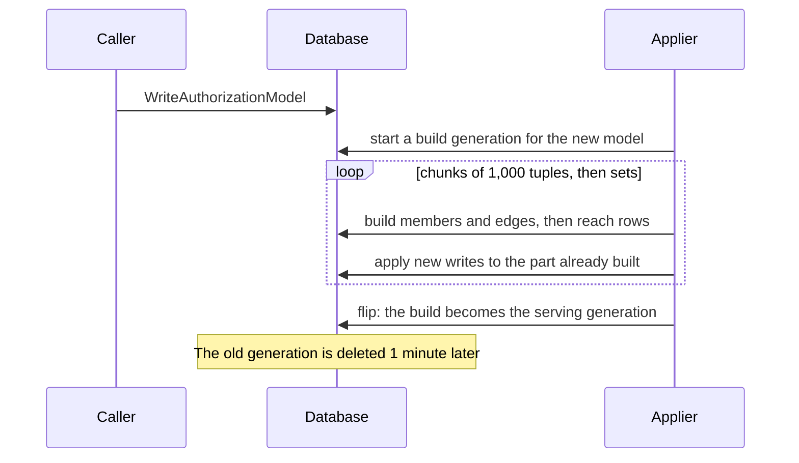

# Gebra

A fine-grained authorization engine for Go, modeled on Google's Zanzibar and compatible with the OpenFGA API and DSL.

Gebra runs embedded in Gogs as a Go package, or standalone as an HTTP server (`cmd/gebra`) that speaks OpenFGA's HTTP API. It stores everything in the application's own database, with Postgres as the database it is tuned for, and SQLite and MySQL supported. It keeps a materialized view of group membership, so checks and lists read precomputed rows instead of walking the graph, and lists are sorted and paged without limits.

## Features

- **OpenFGA model and API**: schema 1.1 DSL, direct and computed relations, tuple to userset, union, intersection, exclusion, type restrictions, wildcards, conditions (CEL), contextual tuples, Check, BatchCheck, Expand, ListObjects, StreamedListObjects, ListUsers, Read, ReadChanges and assertions.
- **Materialized view**: union-only relations are flattened into member, edge and reach rows, so a check is one statement at any nesting depth.
- **Sorting and no query limits**: lists page with keyset cursors over sortable object attributes (`string`, `int` and `time`), with no cap on results or depth.
- **Short write transactions**: a write commits its tuples, one inbox row and its pending changes, and returns. A single applier per store updates the view in batches.
- **Consistency chosen by the caller**: a write returns a revision token. Queries read the view by default, or pass `MinRevision` or `HIGHER_CONSISTENCY` to read their writes. A write can also `Wait` until it is applied.
- **Bounded staleness**: when the view falls more than `MaxStaleness` (1s by default) behind, default queries evaluate the graph instead.
- **Model changes without downtime**: a new model's view is built next to the live one, and queries switch to it at once when it is complete.
- **Observability**: OpenTelemetry traces and metrics for every operation, a client span for every SQL statement, applier lag and inbox depth.

## Architecture

- **Tuples** (`gebra_tuple`) are the source of truth. Read always sees every committed write.
- **Inbox** (`gebra_inbox`) holds the committed writes that the view does not include yet. Its ID is the revision token. `gebra_pending` holds their tuple changes, one row each, so that queries can tell whether a pending write affects their answer.
- **Applier**: one per store, elected with a Postgres advisory lock or MySQL `GET_LOCK`, and an in-process goroutine on SQLite. It is the only writer of the view, the change log and the view state, so the view needs no locks.
- **View**: `gebra_view_member` (direct members of a set), `gebra_view_edge` (set to set) and `gebra_view_reach` (the transitive closure of edges). Every row belongs to a generation, built for one model.
- **Database layer**: plain `database/sql` with explicit SQL, migrated by goose from `migrations/<dialect>`, with its own version table `gebra_db_version`.

A store is the unit of isolation: its tuples share the tables with every other store, but it has its own applier, inbox and view generations. Stores apply writes in parallel, and a store that falls behind does not slow the queries of others. Relations cannot refer to another store.

## Data flow

### Writes

Writes of the same tuple serialize on its row, so the later write gets the higher revision. Writes of different tuples may commit out of order, so a revision counts as applied when no inbox row at or below it is left.

### Queries

- A default check is one statement: the compiled condition on the view, which also verifies the serving generation and that the store exists.
- A token check is also one statement, which adds whether any pending change can affect the answer, from the pending rows and the model's precomputed effects (`gebra_model_effect`).
- Relations with exclusion, intersection or conditions are evaluated from tuples as of the view's point in time, and every statement of a query reads one snapshot.

### Model changes

Until the flip, queries that name no model use the old model from its view, and queries that name the new model evaluate the graph. A newer model cancels the build of an older one.

## Performance

Gebra is benchmarked against OpenFGA through each server's HTTP API, with the same dataset, the same request stream at the same arrival rates, and the same correctness check. On a store of 100,000 repos, with 0 violations:

- **Sustained**: Gebra holds 15,000 requests/s on the 16-vCPU benchmark machine with check p99 of 79 ms, six times OpenFGA's rate, and at least 25,000 requests/s, confirmed on a larger machine.
- **Fast**: Gebra keeps check, token check and list p99 within 20 ms up to 10,000 requests/s, OpenFGA up to 500/s.
- **Overloaded**: offered 20,000 requests/s on the benchmark machine, Gebra completes 19,800/s, but p99 rises to 1.3 s.
- **Latency**: at 2,500 requests/s, Gebra's check p99 is 2.1 ms against 634 ms for OpenFGA.
- **Writes**: in a write-only run, both servers accept 10,000 single writes/s, with p99 of 26 ms for Gebra and 301 ms for OpenFGA. Gebra's view stays within 0.21 s of its writes at that rate.

### Dataset and traffic

- **Dataset**: one store with 100,000 repos, 3,000 users, 1,000 teams and 500 orgs, which is 389,897 tuples. The model is GitHub-like: org owners and members, nested teams, repo admins, writers and readers, public repos (`user:*`) and blocked users (`can_read: reader but not blocked`). Gebra's view holds 308,997 member, 280,900 edge and 801,001 reach rows.
- **Traffic**: requests arrive at random (Poisson) times at a fixed rate, and latency counts from when a request was due, so time spent queued counts too. Users, repos and orgs are picked with a Zipf distribution.
  - 92% are checks.
  - 7% list a page of 50 repos a user reads. Lists may be stale, since opening a repo from a list issues a check.
  - 1% start a change session: a permission change (a collaborator, a team member, a team grant, a block, 100 collaborators at once, or a team added to an org), then, after a think time, a check with the write's token that must see the change, two more checks with the token, and sometimes a list. A check that misses its own write counts as a violation.
- **Rates**: 500, 1,000, 1,500, 2,000, 2,500, 5,000, 7,500, 10,000, 15,000, 20,000 and 30,000 requests/s, for 60 s each after a 10 s warmup, stopping after the first rate at which a p99 exceeds 1 s or the server falls behind the offered rate.
- **Clean state**: each server starts from a fresh database with exactly the dataset's tuples, and Postgres is restarted before each server's run.
- **Cross-check**: before its run, OpenFGA's answers are compared with a freshly loaded Gebra's on 300 checks and 300 lists, both in full and capped at 50. All 600 agree.

### Results

One row per offered rate, with Gebra and OpenFGA side by side: p50 / p99 in milliseconds for each kind of request, and the CPU cores Postgres used. Bold marks the lower p99. Both servers completed the offered rate in every row, except where the summary below says otherwise. Neither server had a violation at any rate, and the only error was one of OpenFGA's at 2,500/s, `400 cancelled: Request Cancelled`.

| Rate/s | Check, Gebra | Check, OpenFGA | Token check, Gebra | Token check, OpenFGA |
|---|---|---|---|---|
| 500 | **1.2 / 2.2** | 2.6 / 10.9 | 0.9 / 10.7 | **1.7 / 3.4** |
| 1,000 | **1.1 / 2.1** | 2.4 / 61.8 | **0.9 / 10.3** | 1.6 / 33.4 |
| 1,500 | **1.0 / 2.1** | 3.0 / 355 | **0.9 / 11.2** | 2.1 / 234 |
| 2,000 | **1.0 / 2.1** | 28.7 / 655 | **0.9 / 11.0** | 9.5 / 492 |
| 2,500 | **0.9 / 2.1** | 70.5 / 634 | **0.8 / 8.9** | 36.8 / 523 |
| 5,000 | **0.8 / 2.2** | saturated | **0.9 / 12.5** | saturated |
| 7,500 | 0.7 / 2.5 | not run | 0.9 / 11.7 | not run |
| 10,000 | 0.8 / 7.8 | not run | 1.1 / 14.1 | not run |
| 15,000 | 0.9 / 79.1 | not run | 1.1 / 66.1 | not run |
| 20,000 | 105.7 / 1,300 | not run | 23.5 / 215 | not run |

| Rate/s | List, Gebra | List, OpenFGA | Write, Gebra | Write, OpenFGA | Postgres cores, Gebra / OpenFGA |
|---|---|---|---|---|---|
| 500 | **2.5 / 4.1** | 3.1 / 15.6 | **2.2 / 5.8** | 3.4 / 12.2 | 0.2 / 0.6 |
| 1,000 | **2.4 / 4.2** | 3.0 / 69.7 | **2.1 / 3.8** | 3.0 / 42.3 | 0.4 / 1.0 |
| 1,500 | **2.3 / 4.3** | 5.4 / 256 | **2.1 / 4.5** | 3.4 / 215 | 0.5 / 1.3 |
| 2,000 | **2.3 / 4.3** | 19.9 / 515 | **2.1 / 4.5** | 16.6 / 451 | 0.7 / 1.4 |
| 2,500 | **2.2 / 4.3** | 49.6 / 493 | **2.0 / 7.7** | 43.2 / 481 | 0.8 / 1.6 |
| 5,000 | **2.2 / 4.7** | saturated | **2.0 / 4.5** | saturated | 1.8 / 2.0 |
| 7,500 | 2.0 / 5.0 | not run | 1.9 / 5.6 | not run | 2.6 |
| 10,000 | 2.3 / 10.4 | not run | 2.3 / 15.0 | not run | 3.9 |
| 15,000 | 2.3 / 83.9 | not run | 2.6 / 84.2 | not run | 5.3 |
| 20,000 | 98.6 / 1,300 | not run | 42.9 / 1,300 | not run | 6.9 |

| Server | Sustained: highest rate held | Fast: check, token check and list within 20 ms p99 | Overloaded: completed at the first rate not held | Bottleneck |
|---|---|---|---|---|
| Gebra | **15,000/s** | **up to 10,000/s** | **19,806/s of 20,000/s**, p99 1.3 s | The machine: at 20,000/s it used 14.1 of 16 vCPUs, 6.9 of them Postgres, 4.8 `cmd/gebra` and 2.4 the load generator |
| OpenFGA | 2,500/s | up to 500/s | 4,586/s of 5,000/s, p99 30 s | OpenFGA's own CPU: the machine used 10.8 vCPUs at 2,500/s, Postgres only 1.6 |

A rate is held when the server completes at least 90% of it with every p99 under 1 s. At Gebra's 20,000/s, the server completes 99% of the rate, but requests queue for over 1 s at p99. That rate is what Gebra can push through in a burst, not a rate to run at. Since Gebra held 15,000/s, its 20,000/s step ran as a second ladder from a restarted Postgres. OpenFGA's ladder stopped after 5,000/s.

Each server runs at its better `GOMAXPROCS`: Gebra at 8 and OpenFGA at its default of 16. With 8, OpenFGA holds only 1,500/s, its check p99 at 1,000/s is 167 ms instead of 62 ms, and no rate keeps its lists within 20 ms p99, since at 2,000/s it uses 6.9 of its 8 threads while the machine has 7 vCPUs free. Its cross-check passes in both runs.

#### Writes

Writes are 1% of requests, at most about 760 tuples/s, so these numbers measure write latency under read load. Write capacity is measured below. Every kind of write had 0 errors at every rate on both servers. Single writes add or remove 1 tuple, bulk writes 100 collaborators at once, and fan-out writes add a team to an org, which reaches all of the org's repos. Catch-up is how long Gebra's view took to include every write once a step ended; until then, default reads may not see a write, and reads with its token always do. p50 / p99 in milliseconds.

| Rate/s | Single, Gebra | Single, OpenFGA | Bulk, Gebra | Bulk, OpenFGA | Fan-out, Gebra | Fan-out, OpenFGA |
|---|---|---|---|---|---|---|
| 500 | **2.2 / 5.8** | 3.4 / 12.2 | **24.0 / 45.2** | 27.6 / 50.8 | none | none |
| 2,500 | **2.0 / 7.7** | 43.2 / 481 | **26.4 / 57.3** | 66.4 / 550 | **1.8 / 3.0** | 6.9 / 447 |
| 5,000 | 2.0 / 4.5 | saturated | 29.7 / 49.6 | saturated | 2.1 / 3.9 | saturated |
| 7,500 | 1.9 / 5.6 | not run | 27.2 / 85.6 | not run | 1.9 / 7.2 | not run |
| 10,000 | 2.3 / 15.0 | not run | 36.6 / 63.6 | not run | 2.3 / 9.5 | not run |
| 15,000 | 2.6 / 84.2 | not run | 32.9 / 127 | not run | 2.4 / 70.1 | not run |
| 20,000 | 42.9 / 1,288 | not run | 81.0 / 1,318 | not run | 42.1 / 1,259 | not run |

Bulk and fan-out writes are few, 22 to 334 and 6 to 134 per step, so their p99 is close to their maximum. Gebra's catch-up stays at 7 to 9 ms at every rate, and its view was never more than 0.14 s behind during a step. At 20,000/s, the second of latency is requests queued in front of `cmd/gebra`, not the applier falling behind.

Adding a user to a team adds one view row, however many repos the team reaches. On an otherwise idle store, on the 18-vCPU machine below, adding a member to a team with read access to 3,000 repos returns in 0.5 ms, default checks see it after 3.4 ms, and the member's first page of 50 repos takes 0.2 ms (medians of 20).

#### Write capacity

A write-only run measures how many writes each server accepts, with the same steps, stop rule and clean state as above, and every request a write. Neither server had a write error. Single writes add or remove 1 collaborator, and bulk writes add or remove 100. Both servers count a write as accepted when they return, which for Gebra is once its tuples are committed and it has a revision token, before its view includes them. View lag is how far Gebra's view was behind its writes at most during a step. While it is more than 1 s behind, default reads evaluate the graph instead. p50 / p99 in milliseconds unless marked s.

| Single writes, rate/s | Completed/s, Gebra / OpenFGA | p50 / p99, Gebra | p50 / p99, OpenFGA | Gebra's view lag |
|---|---|---|---|---|
| 500 | 499 / 499 | **2.0 / 3.5** | 2.4 / 4.1 | 0.00 s |
| 2,000 | 2,007 / 2,007 | **1.9 / 3.4** | 2.2 / 4.6 | 0.00 s |
| 5,000 | 4,990 / 4,991 | **1.9 / 5.8** | 2.5 / 7.2 | 0.09 s |
| 7,500 | 7,503 / 7,503 | 2.0 / 9.5 | **2.5 / 8.9** | 0.02 s |
| 10,000 | 9,986 / 9,989 | **2.4 / 25.5** | 5.1 / 301 | 0.21 s |
| 15,000 | 11,326 / 14,268 | 9.4 s / 15.4 s | **6.8 s / 11.0 s** | 31.2 s |

| Bulk writes, rate/s | Tuples/s, Gebra / OpenFGA | p50 / p99, Gebra | p50 / p99, OpenFGA | Gebra's view lag |
|---|---|---|---|---|
| 20 | 2,047 / 1,962 | **14.9 / 25.8** | 16.8 / 39.9 | 0.01 s |
| 50 | 4,928 / 4,917 | **15.7 / 29.6** | 17.6 / 40.8 | 0.38 s |
| 100 | 9,927 / 9,887 | 22.9 / 13.5 s | **15.6 / 28.6** | 6.6 s |
| 200, Gebra on its own | 19,932 / 16,987 | **16.7 / 29.0** | 35.7 s / 106 s | 4.6 s |

| Server | Single: highest rate held | Single: within 20 ms p99 | Bulk: highest rate held | Gebra's view within 1 s |
|---|---|---|---|---|
| Gebra | 10,000/s | 7,500/s | 50/s in the ladder, 200/s on its own | up to 10,000 single or 50 bulk writes/s |
| OpenFGA | 10,000/s | 7,500/s | 100/s | no view |

- **Single writes at 15,000/s**: Gebra waits for connections from its pool of 96, and the machine is at 14.6 of 16 vCPUs.
- **The bulk ladder's load generator falls behind** once earlier steps have built up changes: it spends 1.7 to 1.8 cores picking collaborators that no pending change holds, while both servers sit mostly idle. Gebra's 13.5 s p99 at 100/s and OpenFGA's at 200/s come from that. Run as its own ladder from a restarted Postgres, Gebra's 200/s step completed 199/s with p99 29 ms, its view up to 4.6 s behind. OpenFGA was not run that way.

Loading took 2 min 7 s for Gebra, with `COPY` and its view build, and 11 s for OpenFGA through its Write API, including the vacuum.

### On a larger machine

At 20,000 requests/s the benchmark machine runs out of CPU: Postgres, `cmd/gebra` and the load generator together use 14 of its 16 vCPUs, which are 8 cores with hyperthreading. On a machine with 18 vCPUs, one thread per core, and 49 GiB of RAM, Gebra holds at least 25,000 requests/s with 0 violations and 0 errors. Rates above 25,000/s were not tried. Latencies are p50 / p99 in milliseconds.

| Rate/s | Completed/s | Check | Token check | List | Write |
|---|---|---|---|---|---|
| 15,000 | 15,018 | 0.5 / 3.2 | 0.5 / 6.5 | 1.1 / 4.2 | 1.6 / 10.2 |
| 20,000 | 20,027 | 0.6 / 50.3 | 0.8 / 31.0 | 1.3 / 49.1 | 2.0 / 55.4 |
| 25,000 | 25,028 | 0.8 / 73.5 | 1.1 / 43.4 | 1.6 / 75.6 | 2.5 / 74.4 |

These runs use `GOMAXPROCS=8` as above, and differ in:

- **Build**: an earlier one, before the applier sent lists to Postgres as arrays, which on the benchmark machine held 10,000 requests/s instead of 15,000/s.
- **Steps**: one run per rate, of 30 s after a 5 s warmup, from a copy of the same dataset.
- **Postgres 15.20** with the settings in the configuration below, except `max_wal_size` 1 GB, `checkpoint_timeout` 5 min, `maintenance_work_mem` 64 MB and `effective_io_concurrency` 1.

### Configuration

The benchmark is `TestApplierBenchHTTP` in `applierbench_http_test.go`, whose doc comment has the commands. Every setting below is chosen so that neither server gets an advantage the other lacks.

- **Machine**: Intel Xeon @ 2.60 GHz (Ice Lake), 16 vCPUs (8 cores with hyperthreading), 31 GiB of RAM, under KVM, with Postgres, both servers and the load generator on it and nothing else running. Go 1.27.4.
- **Postgres 15.20**, shared by both servers. Both databases are vacuumed and analyzed after loading.
  - Memory: `shared_buffers` 4 GB, `work_mem` 16 MB, `effective_cache_size` 16 GB, `maintenance_work_mem` 1 GB.
  - Connections and durability: `max_connections` 300, `synchronous_commit` on, `fsync` on.
  - WAL: `max_wal_size` 8 GB, `checkpoint_timeout` 15 min.
  - Planner: `random_page_cost` 1.1, `effective_io_concurrency` 200, `max_parallel_workers_per_gather` 0.
- **Gebra**, `cmd/gebra` built from this tree, as its own process:
  - `--db-type postgres`, `--db-max-open-conns 96`, which also sets 96 idle connections.
  - `--max-staleness 1s`, the default, which matches OpenFGA's 1s cache TTL below.
  - Tracing off (`OTEL_TRACES_SAMPLER=always_off`), Prometheus metrics on, as for OpenFGA.
  - Sessions set `max_parallel_workers_per_gather=0`, which `cmd/gebra` does for its short index lookups.
  - `GOMAXPROCS=8` (`GEBRA_BENCH_GOMAXPROCS`). With Go's default of one thread per vCPU, Gebra wakes more threads than the vCPUs left beside Postgres and the load generator, and Postgres waits for a CPU as long as it runs. On an 18-vCPU machine at 15,000/s, check p99 was over 75 ms in every run with the default, and 3 to 11 ms in all but one of seven runs with 8. On the benchmark machine at 15,000/s, with the earlier build, 8 completed 13,811/s against 8,126/s with the default.
- **OpenFGA v1.23.0**, started by `testdata/openfga-bench.sh`, which downloads the release and checks its sha256:
  - `--datastore-engine postgres`, `--datastore-max-open-conns 96`, `--datastore-max-idle-conns 96`, to match Gebra's pool.
  - `--check-query-cache-enabled`, `--check-iterator-cache-enabled` and `--list-objects-iterator-cache-enabled`, each with a TTL of 1s, so default reads may be as stale as Gebra's. `HIGHER_CONSISTENCY` bypasses them.
  - `--check-cache-limit 1000000`, since the default of 10,000 entries would cap hit rates; `--cache-controller-enabled=false`, since the TTL already bounds staleness.
  - `--shared-iterator-enabled` and `--experimentals enable-check-optimizations,enable-list-objects-optimizations`, its performance options.
  - `--listObjects-max-results 50`, the page size, since OpenFGA has no paging.
  - `--listObjects-deadline 10s`, `--request-timeout 10s` and `--http-upstream-timeout 10s`, the benchmark's request timeout.
  - `--authn-method none`, `--trace-enabled=false`, `--log-level warn`, playground and profiler off.
- **OpenFGA's `GOMAXPROCS`**: the default of 16 for the results above. A second run with `GOMAXPROCS=8` exported before `testdata/openfga-bench.sh` held less, as the results say.
- **Client**: one Go HTTP client for both servers, with keep-alives and 4,096 connections per host, so that it is never the bottleneck, and a 10s timeout per request.

What differs between the two:

- **Token checks**: Gebra passes the write's revision as `min_revision`. OpenFGA has no revision tokens, so it gets `HIGHER_CONSISTENCY`.
- **Lists**: Gebra returns a page of 50 sorted results. OpenFGA returns the first 50 it finds, unsorted, which favors OpenFGA.
- **Loading**: Gebra loads with `COPY` and builds its view. OpenFGA loads through its Write API. Neither is measured.
- **Rounds**: one round of each.

## Correctness

- Conformance tests cover every Zanzibar and OpenFGA feature listed above, and run against OpenFGA when `GEBRA_OPENFGA_URL` is set.
- Differential fuzzing compared Gebra with OpenFGA on 1,440 models and 35,610 queries. The remaining differences are intentional or OpenFGA bugs, and the minimized cases are replayed by `TestFuzzRegressions`.
- `GEBRA_WRITE_FUZZ` checks after every write that the view gives the same answers as graph evaluation, including across model changes and view builds.
- `GEBRA_PENDING_FUZZ` checks that queries with a token which the view answers despite pending writes give the answers of the latest state.
- Concurrency tests cover out-of-order commits, revision tokens, applier failover, view builds under concurrent writes and cancelled builds, and a check racing an applier batch or a flip.
- The suites run on SQLite, Postgres and MySQL 8.

## Known limits

- **The view falls behind under heavy writes**: on the benchmark machine it stays within 1 s up to 10,000 single writes/s or 5,000 tuples/s in bulk writes. Beyond that, default reads evaluate the graph, which is slower, until it catches up.
- **View builds are slow on large stores**: a build covers one set at a time on one core, so a store of 1 million repos and 1,000 teams takes about 1 h 40 min to make a new model live.
- **Lists sorted by an attribute sort every object the user can access** before paging, so their cost grows with that number. Lists in ID order stop at the page size: 3 ms at p50 on the dataset above.
